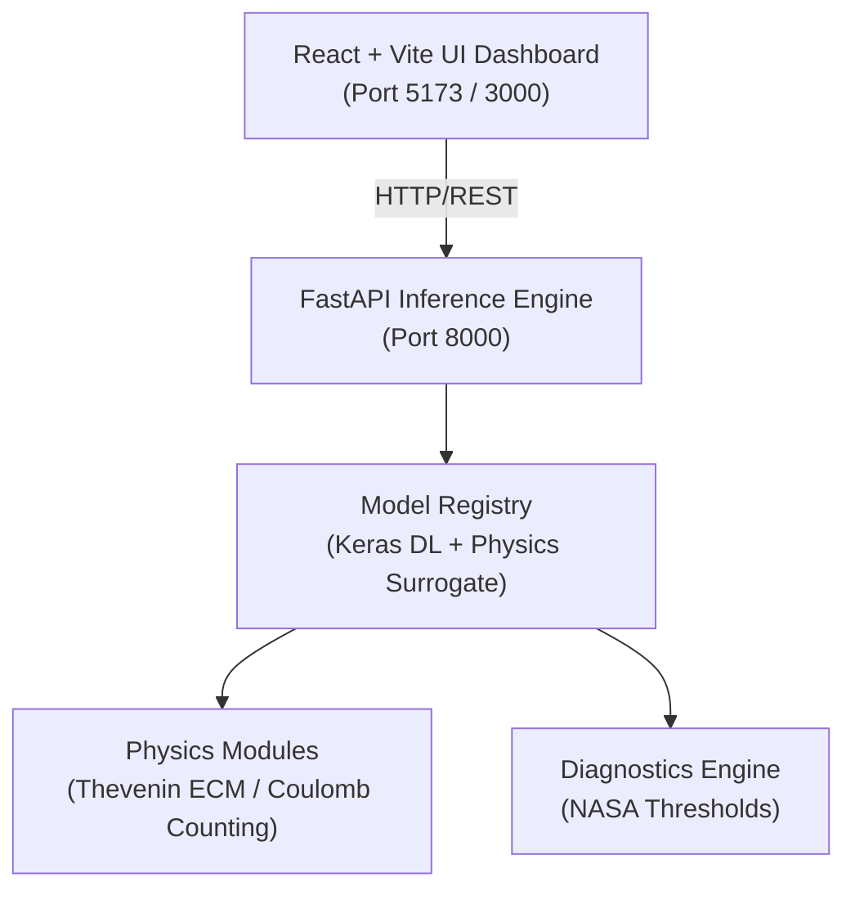

# 🚀 Battery Management System (BMS) — Deployment Guide

This project transforms the Jupyter notebook–based battery research codebase into a **production-ready, containerized Battery Performance Analytics & Diagnostics platform** powered by Hybrid AI + Physics ECM models.

---

## 🏗️ Architecture Overview



---

## ⚡ Quick Start (Local Development)

### 1. Prerequisites
- **Python 3.10+** (tested on 3.11 - 3.14)
- **Node.js 18+** & **npm**

### 2. Start Backend API
```bash
cd backend
python3 -m venv .venv
source .venv/bin/activate
pip install -r requirements.txt

# Run backend
uvicorn app.main:app --host 0.0.0.0 --port 8000 --reload
```
- API Docs: `http://localhost:8000/docs`
- Health check: `http://localhost:8000/api/v1/health`

### 3. Start Frontend Dashboard
```bash
cd frontend
npm install
npm run dev
```
- Open `http://localhost:5173` in your browser.

---

## 🐳 Docker Deployment (Recommended Single-Command Setup)

Run the entire full-stack platform with Docker Compose:

```bash
docker compose up --build -d
```

- **Frontend Dashboard:** `http://localhost:3000`
- **Backend API:** `http://localhost:8000`
- **Swagger Documentation:** `http://localhost:8000/docs`

To stop:
```bash
docker compose down
```

---

## 🧪 Testing & Verification

Run the automated backend test suite:

```bash
PYTHONPATH=backend pytest backend/tests/test_api.py -v
```

All endpoints are verified:
- `test_health`: Status & loaded model check
- `test_soh_predict`: State of Health & equivalent circuit parameter extraction
- `test_soc_predict`: State of Charge dynamic trajectory estimation
- `test_rul_predict`: Remaining Useful Life & confidence interval calculation
- `test_ecm_analyze`: Thevenin / Rint parameter fitting & $R^2$/RMSE metrics
- `test_fault_detect`: Anomaly detection & SEI resistance degradation alerts

---

## 📡 API Reference Summary

| Endpoint | Method | Description |
| :--- | :--- | :--- |
| `/api/v1/health` | `GET` | Health status and model readiness |
| `/api/v1/soh/predict` | `POST` | State of Health (%) and ECM parameters |
| `/api/v1/soc/predict` | `POST` | Dynamic State of Charge (%) trajectory |
| `/api/v1/rul/predict` | `POST` | Remaining Useful Life cycles until 80% EOL |
| `/api/v1/ecm/analyze` | `POST` | Fit Thevenin/PNGV ECM parameters ($R_0, R_1, C_1$) |
| `/api/v1/fault/detect` | `POST` | Detect parameter drift anomalies & alerts |
| `/api/v1/upload/dataset`| `POST` | Ingest CSV battery cycling data |

---

## ☁️ Cloud Deployment Options

### Option A: Railway / Render (Zero Devops)
1. Fork or push this repository to GitHub.
2. In Railway or Render:
   - Create a service pointing to `backend/Dockerfile` with Port `8000`.
   - Create a static site pointing to `frontend` with build command `npm run build` and publish directory `dist`. Set `VITE_API_URL` to your backend URL.

### Option B: AWS ECS / GCP Cloud Run
1. Build and push images to AWS ECR or Google Artifact Registry:
   ```bash
   docker build -t your-org/bms-backend:v1 -f backend/Dockerfile .
   docker build -t your-org/bms-frontend:v1 -f frontend/Dockerfile ./frontend
   ```
2. Deploy to ECS Fargate / Cloud Run with health check path `/api/v1/health`.
