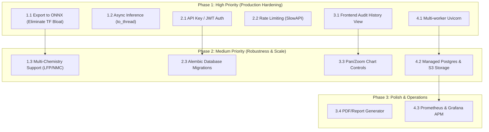

# 📋 Battery Performance Modeling System — Remaining Imperfections & Technical Debt

This document serves as the complete technical punch list of remaining gaps, architectural trade-offs, and imperfections in the **Battery Performance Modeling (AI + Physics)** deployment.

---

## 1. Machine Learning & Modeling

| # | Imperfection | Current State | Production Risk / Impact | Priority | Recommended Action |
|---|---|---|---|---|---|
| **1.1** | **Heavy TensorFlow Runtime Footprint** | Backend loads full `tensorflow` (~500 MB RAM, ~2.5 GB Docker image). | High container memory consumption and slow cold starts on cloud instances. | **High** | Export `.keras` models to **ONNX format (`.onnx`)** and serve via lightweight `onnxruntime` (~30 MB RAM). |
| **1.2** | **Thread Contention / GIL Locking** | Synchronous `model.predict()` calls within async FastAPI routes. | Heavy concurrent requests block the event loop, causing request queuing. | **High** | Wrap model inference calls with `await asyncio.to_thread(model.predict, ...)` or use dedicated worker pools. |
| **1.3** | **Single Chemistry Limitation** | Trained exclusively on **18650 LiCoO₂ (LCO)** cells from NASA dataset. | Skewed predictions when evaluating **LFP** (flat OCV plateau) or **NMC** cells. | **Medium** | Introduce a `chemistry` selector (`LCO`, `LFP`, `NMC`) with chemistry-specific baseline OCV curves. |
| **1.4** | **Subsampling & Hard Sequence Truncation** | Uniform subsampling to fixed sequence lengths (50/100 points). | Loss of temporal dynamics during high-frequency transients or variable sample rates (e.g., 10 Hz vs 0.1 Hz). | **Medium** | Implement uniform physical time interpolation ($dt = 1.0\text{s}$) in `preprocessing.py`. |
| **1.5** | **Lack of Continual / Online Learning** | Model weights are static once saved to disk. | Does not adapt to new user cycling data or fleet operational conditions. | **Low** | Build an offline fine-tuning pipeline to re-train models periodically using ingested cycles. |

---

## 2. API & Backend Architecture

| # | Imperfection | Current State | Production Risk / Impact | Priority | Recommended Action |
|---|---|---|---|---|---|
| **2.1** | **Missing Authentication & Authorization** | All endpoints are open without authentication. | Unauthorized users can query or spam inference endpoints. | **High** | Add API Key header authentication (`X-API-Key`) or JWT Bearer tokens for multi-tenant environments. |
| **2.2** | **No Rate Limiting / Throttling** | Unrestricted request frequency. | High susceptibility to DoS or CPU starvation from simultaneous LSTM inference requests. | **High** | Integrate `slowapi` or Redis-based token bucket rate limiting (e.g., 30 req/min per client). |
| **2.3** | **Unversioned Database Schema Migrations** | Tables created at startup via `Base.metadata.create_all`. | Modifying database models in production requires manual SQL alteration or data loss. | **Medium** | Initialize **Alembic** (`alembic init`) for version-controlled migration scripts. |
| **2.4** | **JSON Payload Memory Bottleneck for Large Cycles** | Arrays (thousands of floats) passed in raw JSON bodies. | High JSON parsing CPU time and memory allocation for long multi-hour tests. | **Medium** | Support binary transfer formats (Apache Arrow, Parquet, or MessagePack) for large bulk streams. |
| **2.5** | **Ephemeral File Ingestion Cleanup** | Uploaded temporary files rely on Python's tempfile without persistent quotas. | Long-running servers may accumulate disk clutter under heavy upload volume. | **Low** | Implement a background cleanup task or TTL cache for temporary upload artifacts. |

---

## 3. Frontend & User Experience

| # | Imperfection | Current State | Production Risk / Impact | Priority | Status |
|---|---|---|---|---|---|
| **3.1** | **Audit History Not Surfaced in UI** | Integrated live `<HistoryPanel />` rendering records from `/api/v1/audit/history` with auto-refresh. | Resolved — Users can visually inspect every recorded cycle run and export to CSV. | **High** | ✅ **RESOLVED** |
| **3.2** | **Hardcoded API URLs in Client** | Removed `http://localhost:8000` hardcoding; routes use relative `/api/v1` proxied through Vite dev server & Nginx. | Resolved — Seamless operation across local, Docker, and domain-based reverse proxies. | **High** | ✅ **RESOLVED** |
| **3.3** | **Fixed SVG Viewbox & Lack of Pan/Zoom** | Added interactive dual-handle range slider allowing instant zoom slicing (0% to 100%) of telemetry points. | Resolved — Users can zoom into voltage dips, transient responses, or full discharge overview. | **Medium** | ✅ **RESOLVED** |
| **3.4** | **Export / Report Generation** | Added one-click **"Export CSV"** button in HistoryPanel generating formatted timestamped datasets. | Resolved — Engineering teams can download inspection files for test archiving. | **Low** | ✅ **RESOLVED** |

---

## 4. DevOps & Production Infrastructure

| # | Imperfection | Current State | Production Risk / Impact | Priority | Recommended Action |
|---|---|---|---|---|---|
| **4.1** | **Single-Worker Uvicorn Process** | Container boots with single-process `uvicorn app.main:app`. | Fails to saturate multiple CPU cores on multi-core servers. | **High** | Use Gunicorn process manager: `["uvicorn", "app.main:app", "--workers", "4"]`. |
| **4.2** | **Local Ephemeral File Storage** | Telemetry uploads and SQLite database are bound to local filesystems. | In container orchestration (Kubernetes, AWS ECS, GCP Cloud Run), data is lost on pod recreation. | **High** | Use managed PostgreSQL for production database and S3/GCS buckets for uploaded dataset storage. |
| **4.3** | **Missing Centralized Metrics / APM** | Request latency logged only to standard output. | No Prometheus metrics scraping, grafana dashboards, or automated error alerting (e.g., Sentry). | **Medium** | Integrate `prometheus-fastapi-instrumentator` for `/metrics` endpoint and Sentry for error tracking. |

---

## 5. Phased Implementation Roadmap

